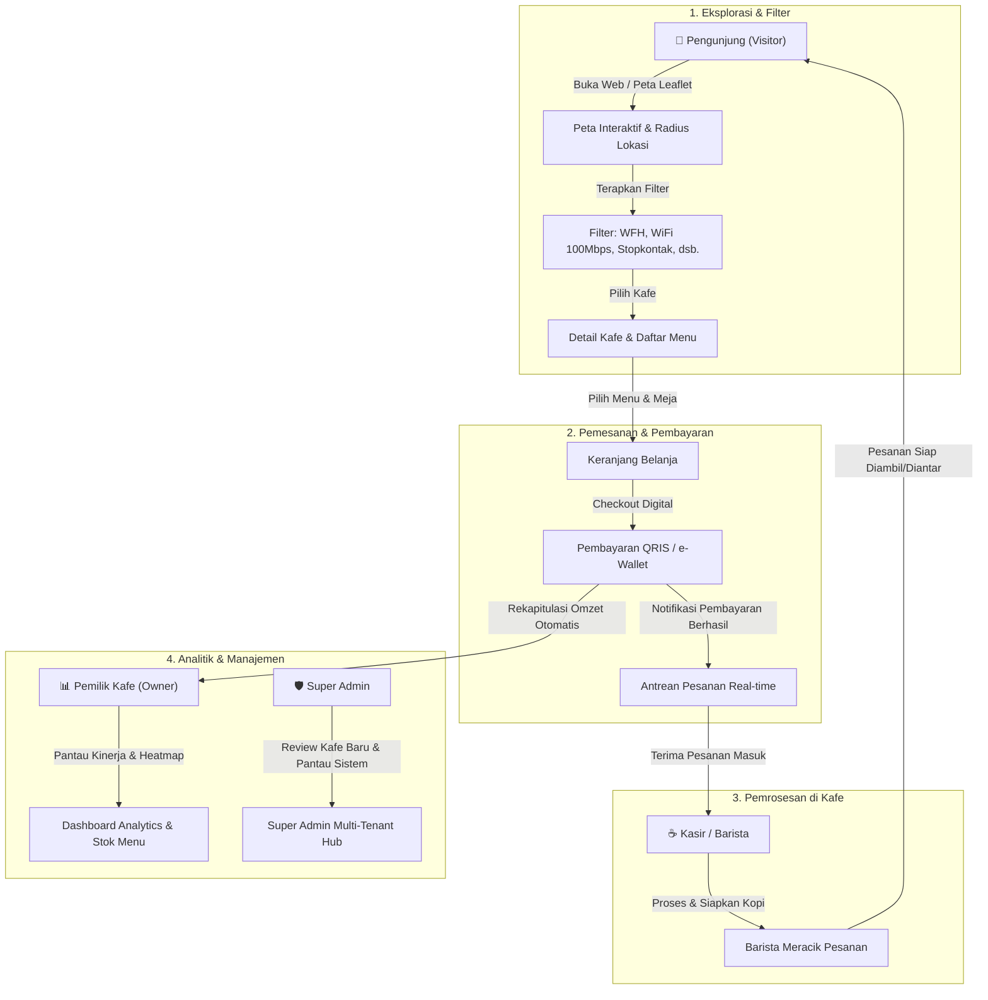

# ☕ Cafe Finder

Platform multi-tenant terintegrasi untuk pencarian kafe pintar, rekomendasi berbasis suasana *(ambiance & facilities)*, pemesanan digital *(digital ordering)*, dan pemantauan operasional kafe secara *real-time*.

---

[](https://laravel.com)
[](https://www.php.net/)
[](https://inertiajs.com)
[](https://react.dev)
[](https://tailwindcss.com)
[](https://leafletjs.com)
[](LICENSE)

---

## 📌 Daftar Isi
- [Tentang Proyek](#-tentang-proyek)
- [Fitur Utama](#-fitur-utama)
- [Tech Stack](#-tech-stack)
- [Alur & Cara Kerja Sistem](#-alur--cara-kerja-sistem)
- [Struktur Folder & Repositori](#-struktur-folder--repositori)
- [Panduan Instalasi & Menjalankan Aplikasi](#-panduan-instalasi--menjalankan-aplikasi)
- [Hak Akses Pengguna (Multi-Role)](#-hak-akses-pengguna-multi-role)
- [Kontribusi & Lisensi](#-kontribusi--lisensi)

---

## 📖 Tentang Proyek

**Cafe Finder** adalah platform ekosistem kafe modern yang menjembatani kebutuhan pengunjung *(coffee enthusiast, remote worker, pelajar)* dengan pemilik kafe independen *(B2B merchant)*.

Platform ini tidak hanya menyediakan direktori kafe biasa, melainkan menghadirkan solusi spesifik seperti:
1. **Pencarian berbasis kebutuhan nyata**: Filter kafe ramah kerja (WFH), koneksi WiFi kencang 100+ Mbps, colokan listrik memadai, meja panjang untuk mabar/diskusi kelompok, hingga ketersediaan mushola dan smoking area.
2. **Peta Interaktif & Navigasi**: Visualisasi radius lokasi kafe terdekat dengan rute jalan kaki maupun berkendara menggunakan Leaflet.
3. **Pemesanan Mandiri & Pembayaran Digital**: Pengunjung dapat memesan menu kopi dan makanan dari meja atau saat perjalanan tanpa perlu antre di kasir.
4. **Multi-Role Operations Hub**: Dashboard khusus untuk Pengunjung (*Visitor*), Pemilik Kafe (*Owner*), Kasir (*Cashier*), dan Administrator Sistem (*Admin*).

---

## ✨ Fitur Utama

### 1. Sisi Pengunjung (Visitor / B2C)
- 🗺️ **Interactive Geospatial Map**: Peta real-time berbasis Leaflet dengan marker dinamis, deteksi lokasi GPS pengunjung, kalkulasi jarak, dan estimasi waktu tempuh (jalan kaki / berkendara).
- 🏷️ **Smart Ambiance & Facility Filter**: Filter instan berdasarkan fasilitas krusial:
  - *WiFi Kencang (100+ Mbps)*
  - *Coworking & WFH Friendly*
  - *Long Table (Mabar / Group Meeting)*
  - *Smoking / Outdoor Area*
  - *Fasilitas Ibadah (Mushola)*
  - *Operasional 24 Jam & Manual Brew V60*
- 🏆 **Curated Podium & Ranking Leaderboard**: Kurasi kafe terbaik mingguan berdasarkan rating rasa, kecepatan WiFi, kenyamanan suasana, dan jumlah *check-in*.
- 📲 **Digital Ordering & Cashless**: Pesan menu espresso/manual brew langsung dari aplikasi dengan integrasi pembayaran QRIS & e-Wallet.
- ⭐️ **Loyalty & Favorites**: Fitur penyimpanan kafe favorit, riwayat kunjungan, dan pengumpulan poin loyalti.

### 2. Sisi Pemilik Kafe (Owner / B2B)
- 📊 **AI & Business Analytics**: Pantau total pendapatan harian/mingguan, *average ticket size*, tren menu terlaris (*Signature Cold Drip, Artisan Pastry*), dan grafik jam sibuk (*hourly peak*).
- 🌡️ **Occupancy Heatmap**: Analisis tingkat keterisian kursi dan kepadatan pengunjung harian.
- 📋 **Live Order Kanban & Menu Manager**: Manajemen ketersediaan stok bahan baku dan status pesanan aktif.

### 3. Sisi Kasir & Barista (Cashier)
- ⏱️ **Real-time Order Queue**: Antrean pesanan masuk yang terurut per nomor meja untuk mempercepat pelayanan barista.
- 💳 **Billing & QRIS Settlement**: Validasi pembayaran digital instan dan penerbitan struk elektronik.

### 4. Sisi Super Admin
- 🏢 **Multi-Tenant Onboarding**: Verifikasi pendaftaran kafe mitra baru dan audit legalitas usaha.
- 📈 **Platform Health & Metrics**: Monitoring uptime server, analitik transaksi per wilayah kota, dan resolusi tiket keluhan.

---

## 🛠️ Tech Stack

### Backend & Core
- **[Laravel 12 / 13](https://laravel.com)**: Framework PHP modern yang menangani arsitektur MVC, routing aman, migrasi database, autentikasi multi-guard, dan *business logic*.
- **[PHP 8.3+](https://www.php.net)**: Bahasa pemrograman backend dengan performa tinggi dan fitur *typed properties* yang ketat.
- **[Inertia.js 2.0](https://inertiajs.com)**: Jembatan penghubung monolitik antara Laravel dan React tanpa memerlukan pembuatan REST API yang rumit (*The Modern Monolith*).
- **[Laravel Breeze & Sanctum](https://laravel.com/docs/starter-kits)**: Modul autentikasi aman dengan perlindungan CSRF, session guard, dan token management.

### Frontend & UI
- **[React 18](https://react.dev)**: Library deklaratif untuk membangun antarmuka pengguna berbasis komponen yang reaktif.
- **[Tailwind CSS v4](https://tailwindcss.com)**: Framework utilitas CSS generasi terbaru dengan integrasi compiler `@tailwindcss/vite` untuk performa render kilat.
- **[Vite 6 / 8](https://vite.dev)**: Build tool modern untuk *Hot Module Replacement* (HMR) dan bundling aset yang sangat cepat.
- **[Lucide React](https://lucide.dev)**: Koleksi ikon antarmuka yang konsisten dan ringan.
- **[Plus Jakarta Sans](https://fontsource.org/fonts/plus-jakarta-sans)**: Tipografi modern bertema kontemporer ramah keterbacaan.

### Peta & Geospasial
- **[Leaflet.js](https://leafletjs.com) & [React Leaflet](https://react-leaflet.js.org)**: Engine peta interaktif open-source untuk merender ubin peta (*tile layers*), rute polyline, dan custom marker kafe.

### Basis Data & Infrastruktur
- **SQLite / MySQL / PostgreSQL**: Penyimpanan data relasional untuk pengguna, role akses, data profil kafe, menu, transaksi, dan log sistem.
- **Laravel Cache & Session**: Manajemen session pengguna dan caching query data.

---

## 🔄 Alur & Cara Kerja Sistem

Diagram berikut mengilustrasikan interaksi end-to-end antara Pengunjung, Kasir, Pemilik Kafe, dan Admin:



---

## 📁 Struktur Folder & Repositori

```text
cafefinder/
├── app/
│   ├── Http/
│   │   ├── Controllers/
│   │   │   ├── Auth/              # Login, Register, Password Reset, Verifikasi Email
│   │   │   └── ProfileController.php # Manajemen akun & profil pengguna
│   │   └── Middleware/            # Validasi request, CSRF, & role guard
│   └── Models/
│       └── User.php               # Model User dengan atribut multi-role
│
├── database/
│   ├── factories/                 # Mock data testing
│   ├── migrations/                # Skema tabel database (Users, Roles, Cache, Jobs)
│   └── seeders/                   # Data awal database
│
├── resources/
│   ├── css/
│   │   └── app.css                # Konfigurasi Tailwind CSS v4 & custom tema
│   └── js/
│       ├── Components/            # Komponen reusabel
│       │   ├── Hero.jsx           # Section pencarian utama & filter cepat
│       │   ├── MapSection.jsx     # Peta Leaflet interaktif, rute, & marker
│       │   ├── Navbar.jsx         # Navigasi utama & auth switch
│       │   ├── Ranking.jsx        # Peringkat kafe podium & leaderboard
│       │   ├── Featured.jsx       # Rekomendasi kafe pilihan
│       │   └── OwnerCta.jsx       # Call-to-action kemitraan pemilik kafe
│       ├── Layouts/               # Layout wrapper (Authenticated & Guest)
│       ├── Pages/
│       │   ├── Welcome.jsx        # Halaman landing page publik
│       │   ├── Dashboard.jsx      # Router dashboard dinamis berbasis role
│       │   ├── Dashboard/
│       │   │   ├── VisitorDashboard.jsx # Dashboard khusus Pengunjung
│       │   │   ├── OwnerDashboard.jsx   # Dashboard analitik Pemilik Kafe
│       │   │   ├── CashierDashboard.jsx # Dashboard antrean Kasir / Barista
│       │   │   └── AdminDashboard.jsx   # Dashboard pengelolaan Super Admin
│       │   └── Auth/              # Halaman login, register, dan reset password
│       └── data/
│           ├── cafes.js           # Metadata kurasi, badge, & fasilitas kafe
│           └── cafes.json         # Data koordinat geospasial kafe (lat, lng, rating)
│
├── routes/
│   ├── web.php                    # Rute navigasi halaman, dashboard role, & profil
│   └── auth.php                   # Rute autentikasi Breeze
│
├── public/                        # Aset publik (gambar kafe, ikon, favicon)
├── vite.config.js                 # Konfigurasi Vite & plugin React + Laravel
└── composer.json / package.json   # Dependensi PHP & Node.js
```

---

## 🚦 Hak Akses Pengguna (Multi-Role)

Sistem menggunakan kontrol akses terpusat (*Role-Based Access Control*) pada route `/dashboard`:

| Role | Akses Dashboard | Deskripsi Tanggung Jawab |
| :--- | :--- | :--- |
| **`visitor`** | `/dashboard/visitor` | Pengunjung umum: melacak pesanan, menyimpan kafe favorit, dan riwayat voucher |
| **`owner`** | `/dashboard/owner` | Mitra pemilik kafe: melihat performa omzet harian, grafik jam sibuk, dan stok menu |
| **`cashier`** | `/dashboard/cashier` | Staf kasir/barista: menangani tiket antrean meja dan pembayaran di tempat |
| **`admin`** | `/dashboard/admin` | Pengelola platform: memvalidasi onboarding kafe baru dan memastikan kesehatan server |

---

## 💻 Panduan Instalasi & Menjalankan Aplikasi

Ikuti langkah-langkah di bawah ini untuk menjalankan proyek Cafe Finder di lingkungan lokal (*development*):

### Prasyarat Sistem
- **PHP** $\ge$ 8.2 atau 8.3 (dengan ekstensi `pdo`, `mbstring`, `openssl`, `tokenizer`, `xml`, `ctype`, `curl`)
- **Composer** $\ge$ 2.x
- **Node.js** $\ge$ 18.x dan **npm**
- **Git**

---

### Langkah Instalasi

#### 1. Clone Repositori
```bash
git clone https://github.com/tomidev23/cafefinder.git
cd cafefinder
```

#### 2. Install Dependensi PHP (Backend)
```bash
composer install
```

#### 3. Install Dependensi JavaScript (Frontend)
```bash
npm install
```

#### 4. Konfigurasi Environment (`.env`)
Salin file `.env.example` menjadi `.env`:
```bash
cp .env.example .env
```

Buka file `.env` dan pastikan konfigurasi database sudah sesuai. Secara default, Anda dapat menggunakan SQLite untuk kemudahan pengujian lokal:
```ini
DB_CONNECTION=sqlite
# Atau jika menggunakan MySQL:
# DB_CONNECTION=mysql
# DB_HOST=127.0.0.1
# DB_PORT=3306
# DB_DATABASE=cafefinder
# DB_USERNAME=root
# DB_PASSWORD=
```

Jika menggunakan SQLite, pastikan file database tersedia:
```bash
touch database/database.sqlite
```

#### 5. Generate Application Key & Migrasi Database
```bash
php artisan key:generate
php artisan migrate
```

*(Opsional) Jika ingin memasukkan data awal/seed:*
```bash
php artisan db:seed
```

#### 6. Jalankan Server Pengembangan
Jalankan backend Laravel dan frontend Vite secara bersamaan:

**Terminal 1 (Laravel Server):**
```bash
php artisan serve
```

**Terminal 2 (Vite HMR):**
```bash
npm run dev
```

> **Tips:** Anda juga dapat menggunakan perintah bawaan composer:
> ```bash
> composer run dev
> ```

Akses aplikasi melalui browser di: **`http://127.0.0.1:8000`**

---

## 🤝 Kontribusi

Kami sangat mengapresiasi kontribusi dari komunitas pengembang! Jika Anda ingin menambahkan fitur baru, memperbaiki bug, atau meningkatkan performa:

1. **Fork** repositori ini.
2. Buat branch baru untuk fitur Anda:
   ```bash
   git checkout -b feature/nama-fitur-baru
   ```
3. Lakukan commit perubahan dengan pesan yang jelas:
   ```bash
   git commit -m "feat: menambahkan integrasi payment gateway Midtrans"
   ```
4. Push ke branch repositori Anda:
   ```bash
   git push origin feature/nama-fitur-baru
   ```
5. Buat **Pull Request** di GitHub.

---

## 📄 Lisensi

Proyek ini dilisensikan di bawah lisensi open-source **[MIT License](LICENSE)**.

---

<p align="center">
  Dibuat dengan ☕ dan dedikasi untuk memajukan kultur kopi lokal & kenyamanan ruang kerja fleksibel.
</p>
